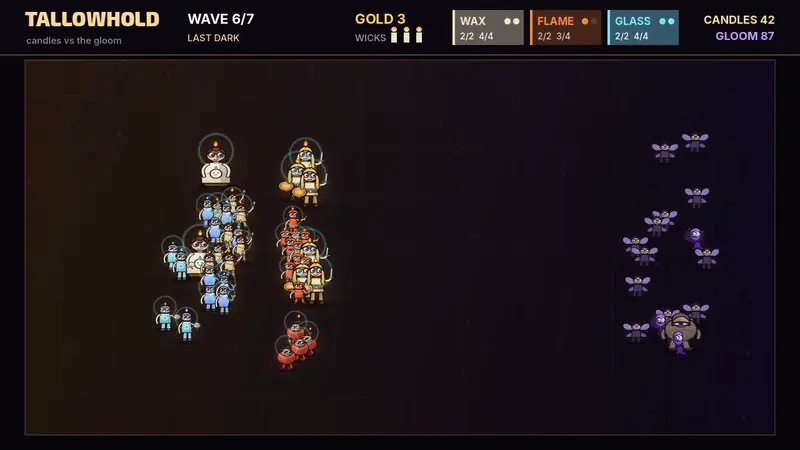
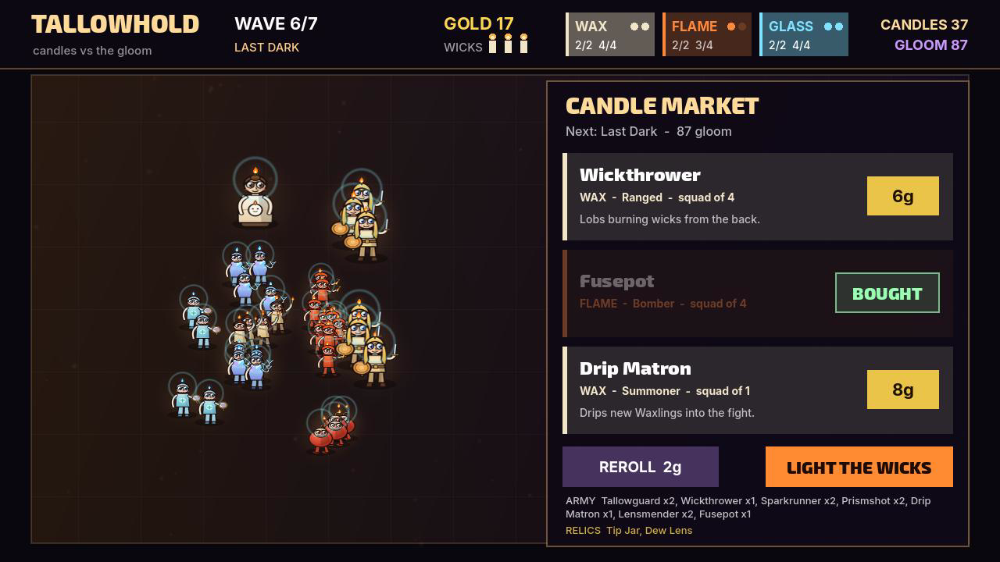
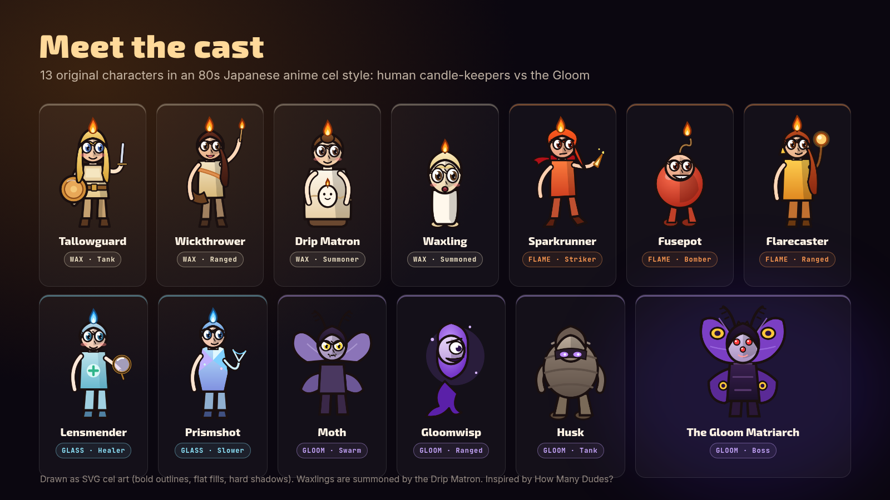
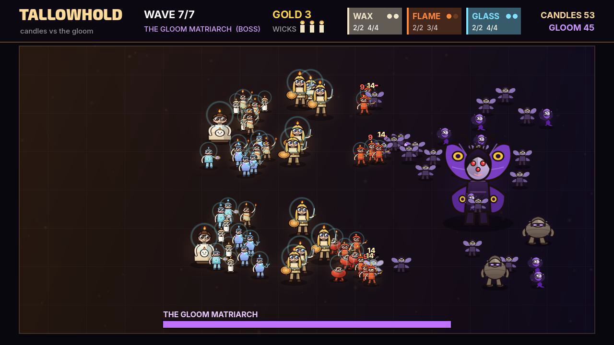
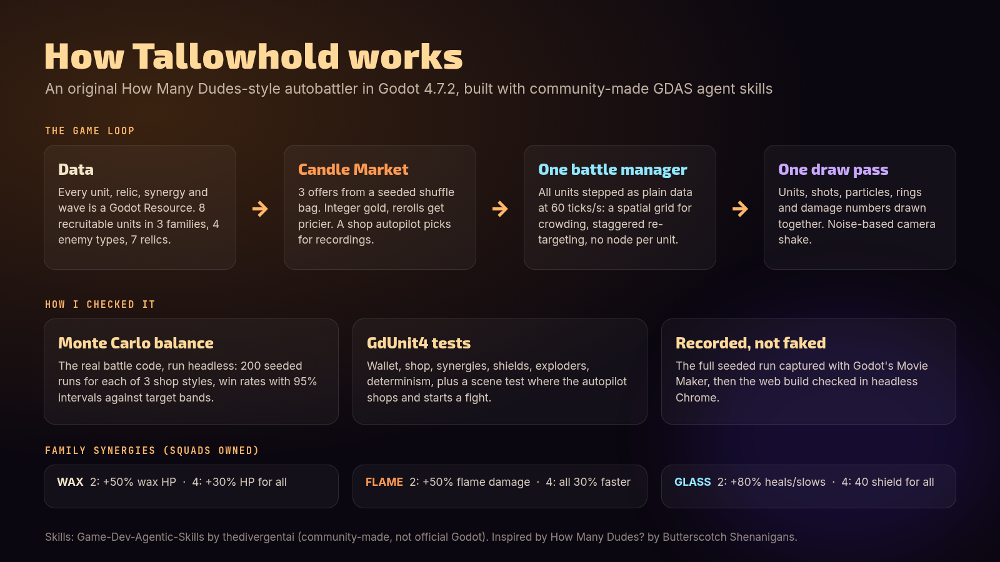
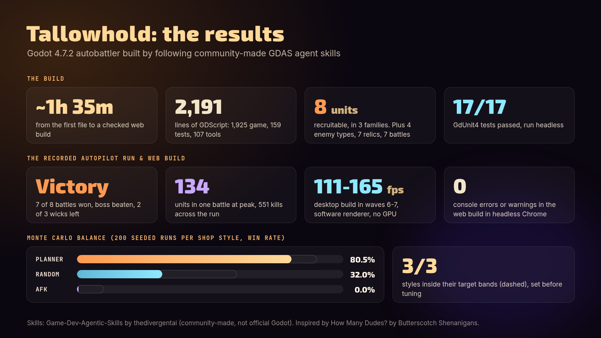
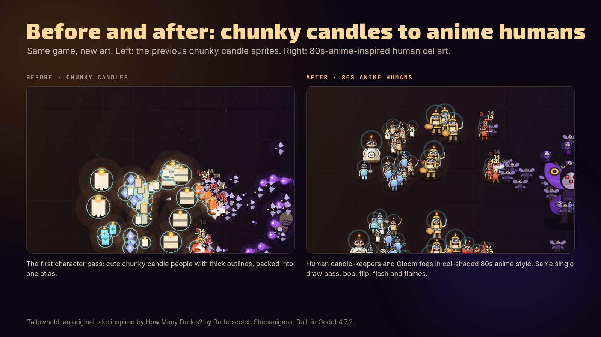

# Tallowhold



Full-quality video: [media/gameplay.mp4](media/gameplay.mp4)

Tallowhold is a roguelike autobattler. An army of living candles holds a hall against the moths of the Gloom. Between battles you recruit squads and relics in the Candle Market, and then the fights play out on their own across 6 escalating waves and a boss, The Gloom Matriarch. It's built in Godot 4.7.2 with the Compatibility renderer and plays in the browser. The cast is 13 characters drawn as 80s Japanese anime-style cel art, generated from code as SVG and packed into one atlas. It's an original take inspired by *How Many Dudes?* by Butterscotch Shenanigans, with its own name, theme, units and text.

## Features

- **Candle Market:** each shop shows 3 offers (squads or relics) from a seeded shuffle bag. Gold is an integer wallet. A reroll costs 2 gold, plus 1 more for each reroll in the same shop.
- **8 recruitable units in 3 families:** WAX (Tallowguard, Wickthrower, Drip Matron, who summons Waxlings), FLAME (Sparkrunner, Fusepot, Flarecaster) and GLASS (Lensmender, Prismshot). Each family has a bonus at 2 squads and a bigger one at 4.
- **7 relics, 4 enemy types and 7 battles.** You have 3 wicks, and each lost battle puts one out.
- **Fully automatic battles:** one `BattleSim` steps every unit as data at 60 ticks/s, with a 32 px spatial grid and staggered re-targeting. There are no per-unit nodes.
- **Data-driven:** every unit, relic, synergy and wave is a `.tres` Resource under `data/`.
- **One draw pass:** units, shots, particles, rings and damage numbers are all drawn from one atlas. Units bob, squash, flip to face their target, flash white when hit, and their candle flames flicker. `--shapes` brings back the original flat shapes.
- A Monte Carlo balancer and a seeded shop autopilot with PLANNER, RANDOM and AFK styles

| Market | Characters | Boss |
|---|---|---|
|  |  |  |

## How to run

You need [Godot 4.7.2](https://godotengine.org/download). The project uses the Compatibility renderer.

```bash
# play (1-3 buy, R reroll, Space fight)
godot --path .

# watch the seeded shop autopilot play a full run
godot --path . -- --autopilot

# run the GdUnit4 tests headless
./addons/gdUnit4/runtest.sh --godot_binary "$(command -v godot)" --headless --ignoreHeadlessMode -a res://tests

# Monte Carlo balance pass (200 seeded runs per style)
godot --headless --path . -s res://tools/balance_runner.gd -- --runs 200

# record the full seeded autopilot run with Movie Maker (writes build/recording/full.avi)
GODOT=godot ./tools/record_full.sh

# web export (needs the Godot 4.7.2 export templates)
mkdir -p build/web && godot --headless --path . --export-release Web build/web/index.html
```

A ready-made web build is attached to the GitHub Release as `tallowhold-web.zip`. Serve the unzipped folder over HTTP to play it.

### Regenerating the character art

The atlas `art/characters_atlas.png` is generated by the scripts in `art-src/anime/`:

```bash
cd art-src/anime
python3 chars_anime.py        # writes the SVGs in svg/
node render.js                # renders them to png/ with headless Chrome (needs puppeteer-core; set CHROME_PATH)
python3 build_atlas.py        # packs png/ into ../../art/characters_atlas.png (needs Pillow)
```

## Tech notes

These are the numbers measured when the game was built:

- 2,191 lines of GDScript, not counting the GdUnit4 addon: 1,925 in the game, 159 in tests and 107 in tools. The character art adds about 500 lines of Python and JS.
- 17/17 GdUnit4 tests pass headless. They cover the wallet, the shop, synergies, the battle sim (shields, exploders, determinism), and a scene test where the autopilot shops and starts a fight.
- Balance, 200 seeded runs per style (seeds 1000-1199):

  | Shop style | Target band | Win rate | 95% Wilson CI |
  |---|---|---|---|
  | PLANNER | 55-90% | 80.5% | 74.5-85.4% |
  | RANDOM | 15-60% | 32.0% | 25.9-38.8% |
  | AFK | 0-10% | 0.0% | 0.0-1.9% |

- Recorded autopilot run (one seed): 14,252 frames at 30 fps, 7 min 55 s of game time. It won 7 of 8 battles and beat the boss with 2 of 3 wicks left, with 551 kills and a peak of 134 units in one battle.
- Desktop: 111-165 fps in waves 6-7 with 28-119 units on screen, on a software renderer (llvmpipe) with no GPU.
- Web: loaded in 0.36-0.64 s in headless Chrome and ran at 33-57 fps, with 0 console errors and 0 warnings across two sessions.

| How it works | Results | Before / after art pass |
|---|---|---|
|  |  |  |

Gameplay video: [media/gameplay.mp4](media/gameplay.mp4). Design and balance notes are in [docs/](docs/).

## Credits

- The code was written by an AI agent following [Game-Dev-Agentic-Skills](https://github.com/thedivergentai/Game-Dev-Agentic-Skills) by thedivergentai. It's a **community-made skill pack, not official Godot**.
- Inspired by [How Many Dudes?](https://store.steampowered.com/app/3934270/How_Many_Dudes_The_Roguelike_Autobattler/) by Butterscotch Shenanigans. Tallowhold is an original game and isn't affiliated with it.
- Tests use [GdUnit4](https://github.com/godot-gdunit-labs/gdUnit4) (MIT), bundled in `addons/gdUnit4/` with its licence.
- Fonts: [Exo 2](https://github.com/googlefonts/Exo-2.0) and [Inter](https://github.com/rsms/inter), both under the SIL Open Font License 1.1 (see `fonts/*-OFL.txt`).
- Built with the [Godot Engine](https://godotengine.org).
